<p align="center">
  
</p>

<p align="center">
  <strong>A self-hosted execution layer for AI agents.</strong><br>
  Connect an agent to any API you need, and enforce exactly what it is allowed to call.
</p>

<p align="center">
  <a href="#quickstart">Quickstart</a> ·
  <a href="docs/README.md">Docs</a> ·
  <a href="docs/security/README.md">Security</a> ·
  <a href="https://github.com/jentic/jentic-public-apis">API Directory</a> ·
  <a href="https://github.com/jentic/jentic-one/discussions">Discussions</a>
</p>

<p align="center">
  <a href="https://github.com/jentic/jentic-one/actions/workflows/ci.yml"></a>
  <a href="LICENSE"></a>
  <a href="https://www.opensourcealternatives.to"></a>
</p>

> [!NOTE]
> **Public beta.** Schemas and CLI commands can change between 0.x releases — pin a version if
> you need stability.

## What it is

<p align="center">
  
</p>

Giving an agent API access normally means giving it an API key. Jentic One removes that step:
you store each credential once, on your own infrastructure, and the agent calls APIs through the
**Broker**. The Broker checks what the agent is allowed to do, attaches the credential, and records
the call. **The agent never sees your keys** — and you can cut off one agent without rotating anything.

Agents connect through the `jentic` CLI, a generated skill, an MCP server, or plain HTTP.

**Who it's for:** developers giving a coding agent (Claude Code, Codex, Cursor, Cline, …) real API
access; teams running agents inside a private network; anyone who has to pass a security review
before an agent touches production credentials.

## Quickstart

The open-source build is the real product — same code and security model as every other install.
Linux and macOS; on Windows use the [Windows guide](docs/installation/windows.md).

### Self-hosted (Docker)

Run the control plane and broker as one stack, on SQLite. This is a trial setup — don't point it at a
real credential. **Back up `.env`**: it holds the key that encrypts stored credentials.

```bash
curl -fsSLO https://raw.githubusercontent.com/jentic/jentic-one/main/deploy/docker/quickstart/docker-compose.yaml
grep -qs '^JENTIC_ENCRYPTION_KEY=' .env || echo "JENTIC_ENCRYPTION_KEY=$(openssl rand -base64 32)" >> .env
docker compose up -d
docker compose exec app python -m jentic_one create-admin --email you@example.com
```

Then sign in at <http://127.0.0.1:8000>.

<details>
<summary>Prefer plain <code>docker run</code>?</summary>

The same setup without compose, using [`config/quickstart.env`](config/quickstart.env).
Back up `quickstart.env` with the volume — it holds the encryption key.

```bash
docker pull ghcr.io/jentic/jentic-one-app:latest
docker volume create jentic-data

# Grab the quickstart config (SQLite on the volume; fetched from main) — tweak it, or use as is.
# Skipped if you already have one, so re-running this block keeps your key.
[ -f quickstart.env ] || curl -fsSLO https://raw.githubusercontent.com/jentic/jentic-one/main/config/quickstart.env

# Generate this install's credential-encryption key into it (once — a new key
# makes credentials stored under the old one unreadable)
grep -q '^JENTIC__CREDENTIALS__ENCRYPTION__' quickstart.env || cat >> quickstart.env <<EOF
JENTIC__CREDENTIALS__ENCRYPTION__ENTRIES__0__ID=v1
JENTIC__CREDENTIALS__ENCRYPTION__ENTRIES__0__MATERIAL=$(openssl rand -base64 32)
EOF

# Migrate, then start the two roles
docker run --rm --env-file quickstart.env -v jentic-data:/data \
  ghcr.io/jentic/jentic-one-app:latest python -m jentic_one.migrations.run
docker run -d --name jentic-app --env-file quickstart.env -v jentic-data:/data \
  -p 127.0.0.1:8000:8000 ghcr.io/jentic/jentic-one-app:latest      # control plane (UI + APIs)
docker run -d --name jentic-broker --env-file quickstart.env -e JENTIC__APPS=broker -v jentic-data:/data \
  -p 127.0.0.1:8100:8000 ghcr.io/jentic/jentic-one-app:latest      # data plane (agents call this)

# First admin (prompts for a password), then sign in at http://127.0.0.1:8000
docker run --rm -it --env-file quickstart.env -v jentic-data:/data \
  ghcr.io/jentic/jentic-one-app:latest python -m jentic_one create-admin --email you@example.com

curl -fsS http://127.0.0.1:8000/health   # verify the control plane is up
```

</details>

The quickstart turns on anonymous telemetry. To opt out, set `JENTIC__TELEMETRY__ENABLED` to
`false` in the compose file (or in `quickstart.env`) — [what is sent](docs/reference/config.md#telemetry). Something failed? See
[Troubleshooting](docs/operations/troubleshooting.md).

### Connect your agent

Install the CLI on the machine where your agent runs, then connect it:

```bash
brew install --cask jentic/tap/jentic    # macOS / Linux

scoop bucket add jentic https://github.com/jentic/scoop-bucket   # Windows
scoop install jentic

jentic setup --url http://127.0.0.1:8000   # registers the agent and installs its skill; approve it in the UI
```

Agents that call Jentic One over plain HTTP or the hosted MCP endpoint don't need the CLI — see
[Connecting agents](docs/guides/connecting-agents.md). Next:
[make your first brokered call](docs/guides/first-call.md).

### Other ways to run it

| If you want… | Go to |
| --- | --- |
| Production on Docker (Postgres, pinned image, TLS) | [Docker](docs/installation/docker.md) · [docker-compose](docs/installation/docker-compose.md) · [systemd](docs/installation/systemd.md) |
| Kubernetes | [Helm](docs/installation/helm.md) |
| Buy it on AWS Marketplace (runs on your EKS) | [AWS Marketplace](docs/installation/aws-marketplace.md) |
| From source, to develop on it | [Local setup](docs/development/local-setup.md) |
| CLI without a package manager | [Installing the CLIs](docs/installation/cli.md) |

## How it works

<p align="center">
  
</p>

Jentic One runs as two units over one database. **App** (the control plane) is where you register
APIs, store credentials and approve agents. **Broker** (the data plane) is what agents call: it checks
permissions, injects the credential after the check, forwards the request and writes an execution
record. More in [Architecture](docs/architecture/README.md).

One boundary to know: the Broker protects credentials from agents running as *other* OS users or on
other machines. An agent running as the *same* OS user as its CLI state can read that state — see
[same-host setups](docs/security/same-host/README.md).

## Documentation

| I want to… | Start here |
| --- | --- |
| Install and run it | [Installation](docs/installation/README.md) |
| Make my first API call through it | [First brokered call](docs/guides/first-call.md) |
| Connect my agent | [Connecting agents](docs/guides/connecting-agents.md) |
| Deploy it securely | [Security](docs/security/README.md) |
| Keep it running (upgrades, backups, monitoring) | [Operations](docs/operations/README.md) |
| Understand how it's built | [Architecture](docs/architecture/README.md) |
| Look up a config key, endpoint or CLI flag | [Reference](docs/reference/README.md) |
| Contribute | [CONTRIBUTING.md](CONTRIBUTING.md) · [Local setup](docs/development/local-setup.md) |

Everything else is in the [documentation index](docs/README.md). AI agents can start from
[`llms.txt`](llms.txt).

## Community

Questions and ideas go to [Discussions](https://github.com/jentic/jentic-one/discussions);
bugs and contributions to the [issues](https://github.com/jentic/jentic-one/issues).
Security reports: [SECURITY.md](SECURITY.md). Support options: [SUPPORT.md](SUPPORT.md).
For commercial use: [jentic.com/contact](https://jentic.com/contact).

## License

[Apache 2.0](LICENSE); third-party attributions in [NOTICE](NOTICE).
