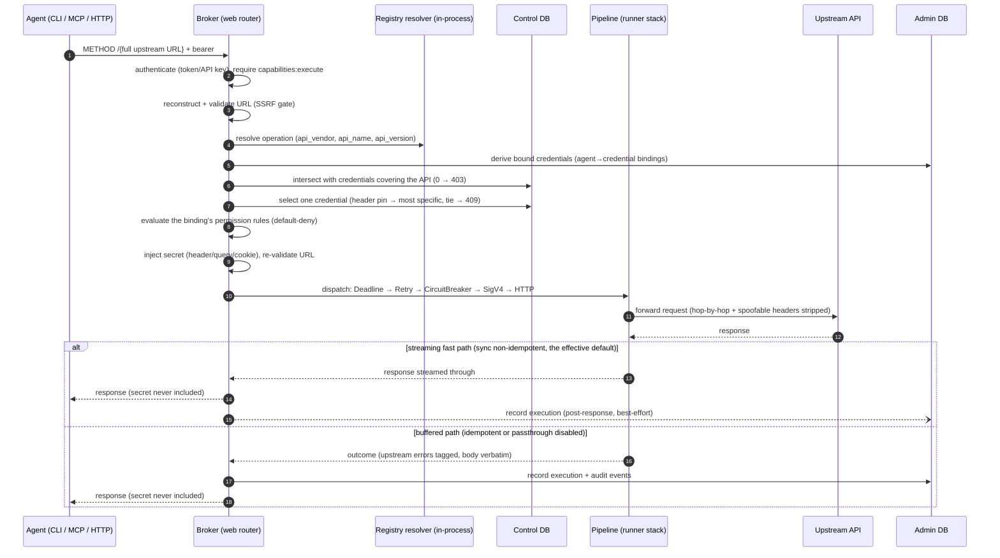

# Broker execution

What happens between an agent's `jentic execute` and the upstream API's
response. The broker ([`src/jentic_one/broker/`](../../src/jentic_one/broker/)) is a credential-injecting
forward proxy with essentially one route: a catch-all
`/{upstream_url:path}` that accepts every HTTP method
([`broker/web/routers/execute.py`](../../src/jentic_one/broker/web/routers/execute.py)).
The vendor CLI facades, registered ahead of it, run the same pipeline for a
vendor's own CLI ([Vendor CLI facades](#vendor-cli-facades)).

## A brokered call, end to end



## One pipeline, two callers — and a streaming fast path

The docstring rule in [`broker/services/execution/pipeline.py`](../../src/jentic_one/broker/services/execution/pipeline.py) is
"one pipeline, two callers": the execution use-case (`run_execution` in
[`broker/services/execution/service.py`](../../src/jentic_one/broker/services/execution/service.py)) is invoked by two paths, and
neither re-implements any step.

- **The sync router.** The catch-all route awaits `run_execution` and adapts
  the outcome to a FastAPI response. This is the buffered path — but note it
  is **not** what most sync requests take by default: with
  `broker.resilience.upstream.stream_passthrough_enabled` (default `true`), a sync
  request without an idempotency key is routed to the **streaming fast
  path** instead, which performs the same permission check, URL validation,
  and credential injection but streams the upstream body straight through
  and writes the execution record *after* the response, in a background
  task. Requests carrying an idempotency key, and installs that disable
  passthrough, take the buffered pipeline below.
- **The async worker.** A request carrying `Prefer: respond-async` is not
  executed inline: the router enqueues a `JobKind.EXECUTION` job and answers
  `202` with a `/jobs/{job_id}` link. The shared `WorkerLoop`
  ([`shared/jobs/worker.py`](../../src/jentic_one/shared/jobs/worker.py)) later hands the job to `ExecutionHandler`
  ([`shared/jobs/execution_handler.py`](../../src/jentic_one/shared/jobs/execution_handler.py)), which re-validates the URL, injects
  the credential, and dispatches through the same runner stack. The seam is
  two protocols (`UpstreamExecutor`, `CredentialInjector` in
  [`shared/jobs/protocols.py`](../../src/jentic_one/shared/jobs/protocols.py)) implemented broker-side by `PipelineExecutor`
  and `CredentialService` — so [`shared/jobs/`](../../src/jentic_one/shared/jobs/) never imports [`broker/`](../../src/jentic_one/broker/)
  (enforced by [`tests/arch/test_worker_no_inline_dispatch.py`](../../tests/arch/test_worker_no_inline_dispatch.py)).

Results of async executions are polled through the jobs API
(`GET /jobs/{job_id}`, `GET /jobs/{job_id}/result`) or the
`get_execution_result` MCP tool.

## The Broker protocol and `DefaultBroker`

[`shared/broker/broker.py`](../../src/jentic_one/shared/broker/broker.py) defines the `Broker` protocol — `execute()`
(buffered) and `execute_streaming()` (passthrough). `DefaultBroker`
([`broker/default_broker.py`](../../src/jentic_one/broker/default_broker.py)) is the stock implementation wrapping the
`BrokerExecutionPipeline`; a deployment (or the enterprise overlay) can
inject its own via `app.state.broker` / `app.state.broker_factory`, and
`BaseBrokerComplianceTest` in `jentic_one.testing` pins the contract.

## The resilience stack

The outbound call is a decorator chain over one shared `httpx.AsyncClient`
(the runners live in [`broker/adapters/runners/`](../../src/jentic_one/broker/adapters/runners/)), composed in two stages:
the broker app lifespan ([`broker/web/app.py`](../../src/jentic_one/broker/web/app.py)) wraps the transport with the
SigV4 signer and the optional circuit breaker, then `build_runner`
([`broker/services/execution/pipeline.py`](../../src/jentic_one/broker/services/execution/pipeline.py)) adds the retry loop and the
outermost deadline:

```
DeadlineRunner( RetryRunner( CircuitBreakerRunner( SigV4SigningRunner( HttpRunner ))))
```

- **`DeadlineRunner`** — outermost whole-call wall-clock budget, distinct
  from per-attempt transport timeouts; expiry is a `504` with a `wait`
  directive.
- **`RetryRunner`** — retries only when safe: the failure happened before
  the request was sent, or the method is idempotent, or the caller supplied
  an idempotency key. Exponential backoff with full jitter; honors
  `Retry-After` on 429/503; never retries a streaming response.
- **`CircuitBreakerRunner`** — a per-upstream-host breaker over the shared
  state backend (memory or Redis), so one failing vendor cannot burn the
  budget of every call.
- **`SigV4SigningRunner`** — innermost signer for AWS-shaped credentials;
  re-signs on every retry attempt; a no-op otherwise.
- **`HttpRunner`** — the only place a request actually leaves the process
  (pinned by [`tests/arch/test_broker_runner_seam.py`](../../tests/arch/test_broker_runner_seam.py)); per-host concurrency
  bulkhead, mid-stream response-size cap, raw-byte streaming.

At the web edge, admission control sheds load when too many requests are in
flight ([`broker/web/middleware.py`](../../src/jentic_one/broker/web/middleware.py); a request counts until its
response is complete, not through any post-response background work) and a per-caller rate limiter answers
`429` with `RateLimit-*` headers ([`broker/web/deps.py`](../../src/jentic_one/broker/web/deps.py)).

## Egress controls

Two layers keep the proxy from being used against the network it runs in:

- **Pre-request validation** ([`shared/url_validation.py`](../../src/jentic_one/shared/url_validation.py)) — `http`/`https`
  only; private, loopback, and link-local ranges refused; cloud metadata
  endpoints are a hard, non-overridable deny. Operators can exempt specific
  private subnets/domains via `EgressConfig`.
- **Connection-time DNS pinning** ([`shared/egress.py`](../../src/jentic_one/shared/egress.py)) — re-resolves and
  re-validates at connect time and pins the connection to the validated IP,
  closing DNS-rebinding races. Redirects are not followed
  (`follow_redirects=False`); the egress layer owns redirect policy.

Validation runs again after server-variable substitution, in both the sync
and async callers, so an injected variable cannot smuggle in a new host.

The platform's own OAuth calls (credential and OAuth app `token_url` /
`authorize_url` checks, the endpoints an approver confirms for their own
client on a connect session, token exchange and refresh, device authorization,
the identity probe) use the same two layers under `control.egress`, and always
pin DNS. `control.egress` holds only `allowed_private_subnets` and
`allowed_internal_domains`; each one left unset is taken from `broker.egress`,
so an in-network token endpoint allowlisted for the broker is reachable for
these calls too. Set a key to give these calls a different value (`[]` blocks
every private range for them even when the broker allows one).

The policy is read by whichever process makes the call. The control surface
makes the credential and OAuth app writes, the connect-session confirm, the
code exchange, device authorization and the identity probe; the **broker
surface** makes the token refresh it runs before injecting an OAuth2
credential, under its own `control.egress` (inherited from its own
`broker.egress`). In a combined deployment that is one config. With one process
per surface, set `control.egress`, and the `broker.egress` keys it inherits,
identically on the control and broker surfaces; otherwise a token endpoint
accepted at create time can be refused at refresh (or the reverse), and a
narrower `control.egress` set on the control surface alone does not constrain
the refreshes the broker sends.

## Credential injection

`CredentialService` ([`broker/services/credentials/orchestrator.py`](../../src/jentic_one/broker/services/credentials/orchestrator.py)) is the
one place a secret meets a request:

1. **Resolve** against the control DB by the API identity tuple
   (`api_vendor`, `api_name`, `api_version`; `NULL` = wildcard,
   most-specific match wins), restricted to the caller's bound credentials
   and honouring the `Jentic-Credential-Id`/`-Name` header pins. No usable
   secret → `424` with a *provision this credential* pointer; a genuine tie
   → `409 ambiguous_credential_binding` listing the candidates. See
   [How credential resolution works](../guides/credentials-and-toolkits.md).
2. **Refresh** OAuth tokens when expired (transient failures and
   needs-reconnect are distinct errors).
3. **Inject** per credential type ([`broker/core/injection.py`](../../src/jentic_one/broker/core/injection.py)): bearer or
   basic `Authorization` headers, API keys into header/query/cookie, SigV4
   as signing material for the runner. The response path never carries the
   secret back.
4. **Audit** — every resolve/decrypt emits a `CREDENTIAL_ACCESSED` event.

Before any of that, the binding deriver
([`broker/repos/credential_binding_resolver.py`](../../src/jentic_one/broker/repos/credential_binding_resolver.py), wrapped by the
short-TTL cache in [`caching_credential_deriver.py`](../../src/jentic_one/broker/repos/caching_credential_deriver.py)) works out which
credentials the caller may use for the call — a single cross-DB lookup
intersecting the agent's credential bindings (admin DB) with the active
credentials covering the API (control DB); none → `403
no_credential_binding` (or `403 credential_identity_mismatch` when a bound
credential is a near-miss, `403 credential_binding_suspended` when the
agent's binding covering the API is suspended), several → resolution disambiguates (or asks for
`Jentic-Credential-Id` with a `409`) — and the winning binding's permission
rules are evaluated **default-deny**: no matching rule, no call
([`broker/repos/agent_rule_evaluator.py`](../../src/jentic_one/broker/repos/agent_rule_evaluator.py)).
Rule paths match the request path **relative to the API's server URL** — the
spec's path (`/widgets/42`), normalized, never the full upstream path with
the server's base path (`/eu/widgets/42` for a server `http://host/{region}`).
Discovery rebuilds that path from the matched operation
(`OperationInfo.relative_path`), so the rule editor's preview, the
`permissions:test` dry-run and enforcement all judge the same path; the
evaluation loop itself is shared
([`shared/permissions/evaluation.py`](../../src/jentic_one/shared/permissions/evaluation.py)).
Normalization never decodes an encoded separator (`%2F`, `%5C`) — the raw URL
is forwarded, so rules must not see a different segment structure than the
upstream gets — and a path that spells a dot segment with escapes or a
backslash is denied
(`ambiguous_path`)
([`shared/url_path.py`](../../src/jentic_one/shared/url_path.py)).
Rules written with the base path baked in can be fixed with
`jentic_one rewrite-rule-base-paths` (see
[upgrades](../operations/upgrades.md#binding-rules-written-against-the-full-upstream-path));
until then the broker logs `rule_written_with_server_base_path` whenever such
a rule changes a verdict, in either direction.
Authorization is direct-only: the retired toolkit path and its
`broker.direct_bindings_enabled` fallback were removed with the phase-6b
table drops (setting the flag to `false` now fails config validation).

### Cache invalidation and staleness bounds

The broker's hot path caches three kinds of authorization lookups in memory per
process:

- **Token and actor-status verdicts** ([`broker/core/token_validation.py`](../../src/jentic_one/broker/core/token_validation.py),
  bounded by `broker.resolve_cache_ttl_seconds`, default `30` s).
- **Direct credential-binding derivations** ([`broker/repos/caching_credential_deriver.py`](../../src/jentic_one/broker/repos/caching_credential_deriver.py),
  bounded by `broker.toolkit_cache_ttl_s`, default `30` s).
- **Permission-rule lists** ([`broker/repos/agent_rule_evaluator.py`](../../src/jentic_one/broker/repos/agent_rule_evaluator.py),
  bounded by `broker.rule_cache_ttl_s`, default `30` s).

`install_broker_auth` ([`broker/core/setup.py`](../../src/jentic_one/broker/core/setup.py)) registers a
`BrokerCacheInvalidator` on the shared `Context` (`ctx.invalidate_broker_caches(...)`).
When an agent's credential binding is bound/unbound/resumed, an agent is
disabled/enabled/archived/purged, an API key or OAuth token is rotated or
revoked, or a credential or permission rule set is updated/deactivated/deleted
in the **same process** (e.g. single-process harnesses and in-process tests),
the hook immediately evicts the affected deriver, rule-evaluator, and
token/actor-status cache entries with zero wait for the TTL.

In **multi-process deployments** (where the broker runs in its own process or
across multiple stateless replicas), each broker instance holds its own
in-memory LRU caches and does not share the control plane's `Context`. Cross-process
propagation is bounded by the configured TTLs above (default `30` s; set the
respective TTL to `0` to disable caching). Queued async executions bypass these
caches and re-authorize against live database state when the worker claims the
job (`build_queued_execution_authorizer`).

## Vendor CLI facades

A facade lets a vendor's own CLI, pointed at the broker with its base-URL
override, run through this pipeline
([`broker/web/routers/facades.py`](../../src/jentic_one/broker/web/routers/facades.py),
[`broker/core/facades.py`](../../src/jentic_one/broker/core/facades.py)). Each facade is a
real route registered before the catch-all, under the reserved `/_facade`
prefix: its first segment starts with an underscore, which no hostname can
contain, so it never shadows a URL the catch-all would proxy. Any other path
under `/_facade` answers 404. Facades are off unless `cli_facades.enabled`
and the vendor's own `enabled` are both set, checked on every request.

The Cloudflare facade (`cf`, `CLOUDFLARE_API_BASE_URL=<broker>/_facade/cloudflare`)
maps `/_facade/cloudflare/<path>?<query>` to
`https://api.cloudflare.com/client/v4/<path>?<query>`, with the path and query
kept exactly as the client encoded them. A call differs from a proxied one in
these ways:

- **Authentication.** Only a `cit_` CLI invocation token minted for the
  vendor is accepted ([identity and authorization](identity-and-authorization.md)).
  The call spends the agent's rate limit as a proxied call does.
- **Trace and credential.** The call is recorded under the token's
  server-chosen trace id, so a command's calls group together, and runs in a
  span on that trace whatever `traceparent` the client sent. The token's
  credential name takes the place of the `Jentic-Credential-Name` header in
  credential selection; the `Jentic-Credential-*` request headers are not read.
- **Headers.** Inbound headers carrying an invocation token, and inbound
  trace context, are never forwarded. Response headers go through an
  allowlist, so an upstream `Set-Cookie`, `Location` or `WWW-Authenticate`
  never lands on the broker's origin.
- **Errors.** The CLI cannot read Problem Details, so the facade's route class
  sets an error-response hook that the central exception handlers apply to
  the response they built (`apply_route_error_response_hook` in
  [`shared/web/errors.py`](../../src/jentic_one/shared/web/errors.py)): the error keeps its status and is
  rendered as Cloudflare's envelope,
  `{"success": false, "errors": [{"code": <status>, "message": "Jentic: …"}], "messages": [], "result": null}`,
  with the problem's detail and agent directive in the message.
- **Holds.** A call a rule holds for approval is filed as usual and answered
  with a 409 error naming the held execution, its review URL and its result
  link, instead of the 202 held envelope, which a CLI would misread as the
  operation's response. A facade call always runs synchronously.

## What gets recorded

Executions land as append-only `ExecutionRecord` rows in the admin DB
([`shared/executions/ingest.py`](../../src/jentic_one/shared/executions/ingest.py)): status, duration, operation and API
identity, HTTP status, actor, origin, and the credential used (by id and
name, never the secret). On the buffered and async paths the write happens
before the response. On the streaming fast path every outcome — completed,
failed partway through the body, or cut off by a client disconnect — writes
exactly one record, and the write is **best-effort** and never holds the
response: it is handed to the app's background-task registry
([`shared/web/background_tasks.py`](../../src/jentic_one/shared/web/background_tasks.py))
and bounded by `broker.streaming_persist_timeout_s`; on shutdown the registry
drains for up to `services.background_task_drain_timeout_s` before the
databases close. A database failure, timeout, or shutdown cancellation is
logged and counted (`broker.streaming_execution.persist_failures`,
`app.background_tasks`, [monitoring.md](../operations/monitoring.md)) but does
not fail the call, so a call can, rarely, lack its record. Concurrent streaming
persists are capped per process (`broker.streaming_persist_max_concurrency`,
clamped to `databases.admin.pool_max - 1`, the admin base pool less one;
SQLAlchemy's default overflow can open up to 10 connections beyond `pool_max`).
An excess persist waits for a slot for at most
`broker.streaming_persist_acquire_timeout_s` and is then abandoned and counted
(`reason="backlog_timeout"`); the queue is visible as
`broker.streaming_execution.persist_pending`. The wait never touches admission:
a request releases its admission slot as soon as its response is complete or its
client disconnects, so persists queued behind a stalled admin database count
neither toward `broker.admission.in_flight` nor toward `/ready` saturation. The
acquire timeout bounds how many records such a stall keeps queued in memory and
how long a *queued* record holds up shutdown; a persist that already holds a
slot and is writing runs under the task registry's
`broker.streaming_persist_timeout_s` budget and the admin pool's checkout
timeout. When the upstream fails partway through a streamed body, the status
line has already been sent: the broker logs one `upstream_network_failure` (or
`streaming_response_aborted` for a size-cap or transfer-deadline cut-off) and
closes the connection without the final chunk, so an HTTP/1.1 chunked or HTTP/2
client sees a truncated body (an HTTP/1.0 client reads a close-delimited body
and cannot tell). Lifecycle events (`EXECUTION_COMPLETED` /
`EXECUTION_FAILED`), permission denials (`PBAC_DENIED`), and credential
incidents each emit typed events into the monitor.

## Related

- [Composition and processes](composition-and-processes.md) — why the broker
  always runs alone, and how its runner stack is assembled at startup.
- [Identity and authorization](identity-and-authorization.md) — the token
  kinds the broker's composite validator accepts.
- [`docs/reference/endpoints.md`](../reference/endpoints.md) — the permission
  each route requires.
