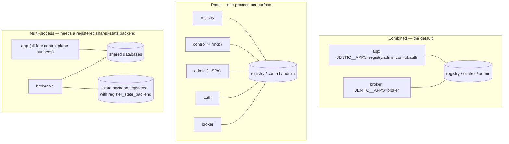

# Composition and processes

How one Python package becomes the processes you deploy: what happens between
`python -m jentic_one` and a serving FastAPI app, which surfaces share a
process, and which background work rides along.

## Boot sequence

```
python -m jentic_one
  └─ __main__.py        load_config() → configure logging/tracing/metrics
       └─ Context(config, allowed_dbs=…)      # DB gate computed from JENTIC__APPS
            └─ wiring.build_default_container(ctx)   # cross-surface seams
                 └─ app factory                       # per-surface or combined
                      └─ uvicorn.run(app)
```

- **`__main__.py`** owns process concerns: config loading, observability
  setup, the `create-admin` first-run subcommand, and the guard that disables
  `server.reload` on a SQLite admin DB (a single-file DB cannot take multiple
  writer processes).
- **`Context`** ([`shared/context.py`](../../src/jentic_one/shared/context.py)) carries config plus lazily-opened
  database handles, gated by `allowed_dbs` (below).
- **`wiring.py`** is the composition root (see
  [surfaces and layering](surfaces-and-layering.md)); it builds the
  `AppContainer` — the DI seam carrying an optional injected `Broker`, extra
  routers, extra installers, and extra lifespans. The enterprise overlay and
  other downstream packages extend the system here, not inside surfaces.
- **The app factories** ([`shared/web/app_factory.py`](../../src/jentic_one/shared/web/app_factory.py)) assemble either one
  standalone surface app (`SURFACE_MODULES[surface].create_app`) or a
  combined app that includes every selected surface's routers in one shared
  root namespace — only the per-surface health routers carry a prefix
  (`/registry/health`, `/control/health`, …); business routes such as
  `/apis` and `/credentials` are served unprefixed.

## `JENTIC__APPS` selects the surfaces

One image, one package, any shape: the comma-separated `JENTIC__APPS`
environment variable decides which surfaces a process serves. Two rules are
enforced at boot:

- **The broker runs alone.** `_build_app` raises if `broker` appears with any
  other surface. The data plane holds decrypted secrets in memory during
  injection; keeping it in its own process keeps that memory out of the
  control plane and lets the two scale independently.
- **Databases are gated per shape.** `Context` only opens the databases the
  surface set needs. Each surface implies its own DB, widened by
  `SURFACE_DB_DEPS` in `__main__.py`: `broker` needs all three (resolve
  against registry, credentials from control, audit into admin); `auth`
  needs admin + control; standalone `control` needs admin (its local auth
  verifier resolves API keys and permissions there); standalone `registry`
  needs admin for the same reason plus control (`/governed-hosts` derives the
  caller's credential scopes from control's credentials table); and a
  control shape with MCP enabled needs registry (the `/mcp` search tools
  call registry services in-process). Touching a DB outside the gate raises
  immediately, so a mis-deployed process fails at boot.

## Deployment topologies



- **Combined** — two containers: everything except the broker in one
  process, the broker in the other. What
  [`deploy/`](../../deploy/README.md)'s compose files and the Helm chart's
  default values produce.
- **Parts** — each surface standalone, fronted by a gateway that routes by
  path prefix. Standalone apps serve at root (`/health`, not
  `/registry/health`); the combined app keeps the per-surface health
  prefixes so the probes don't collide. Agent-discovery documents
  (`/llms.txt`, `/skills/*`) are mounted on every standalone surface so a
  split deployment still serves them.
- **Multi-process** — not supported by OSS on its own. Each surface keeps
  its rate-limit buckets, circuit-breaker counters, `Idempotency-Key`
  records and the auth surface's single-use markers in its process (the
  `memory` shared-state backend), so a second process of the same surface
  gets its own copy. **OSS supports one process per surface** (the combined
  and parts shapes above); several processes need a shared backend
  registered with `register_state_backend`
  ([extending-jentic-one.md](../development/extending-jentic-one.md)). The
  topology rules: [Scaling and tuning](../operations/scaling-and-tuning.md#process-topology).

## One shared-state backend per process

A process builds one shared-state backend from the top-level `state:`
section (`Context.state_backend`) while its app is assembled, so an unknown
`state.backend` fails before the process serves, with the list of registered
names. Every surface the process serves shares it — in the combined app the
auth limiters and single-use markers and the control connect limiters; in a
broker process the rate limiter, circuit breaker and idempotency store. The
broker's auth-failure counters, the circuit-open event dedupe and the MCP
session-event dedupe and per-client caps live on it too, so no surface keeps
cross-request state in a module global. A surface whose limiter or backend
was not wired at assembly fails with a `RuntimeError` naming the missing
wiring rather than building a private in-memory one. The app lifespan closes
it once, after every surface teardown.

The JWT-bearer `jti` replay records are the exception: they live in the
admin database (`assertion_jtis`), so a replayed assertion is refused by
every auth process sharing it, whatever the state backend.

The same backend carries the repeated-failure counters that gate the
`execution.repeated_failure` database scan, in their own `repeated_failure`
key namespace so a failure storm cannot crowd out idempotency or other shared
state; when that namespace is full the counter fails open and every failure
runs the scan. On a shared backend the count is cluster-wide. A shared store
that evicts live keys (every counter key carries a TTL) makes the gate
undercount without raising, so size it to hold them.

The `memory` backend is bounded: each key namespace has a fixed budget, a
live entry is never evicted, and a write into a full namespace is refused with
a `503`. Budgets, idempotency capacity and how to raise them:
[Scaling and tuning](../operations/scaling-and-tuning.md#the-memory-shared-state-backend).

## Lifespan ordering

`create_surface_app` wires one lifespan per process, and teardown order is
load-bearing:

1. **Startup:** `ctx.startup()` → DB instrumentation → telemetry → the
   surface's own `extra_lifespan` (the broker opens its shared outbound
   `httpx.AsyncClient` here) → container-injected lifespans (the `/mcp`
   session manager) → background workers.
2. **Shutdown**, with a drain step first: the broker's admission gate
   reports unready (so the load balancer deregisters the instance) →
   scanners stop → the job worker drains → telemetry flushes →
   `ctx.shutdown()` → container-injected lifespans exit in reverse → the
   surface lifespan closes the shared HTTP client → the shared-state
   backend closes, last. Draining the worker
   *before* closing the client matters: an async execution mid-flight must
   finish over a live connection pool.

## Background work

Four loops start inside the lifespan:

| Loop | Runs when | Job |
| ---- | --------- | --- |
| `WorkerLoop` ([`shared/jobs/worker.py`](../../src/jentic_one/shared/jobs/worker.py)) | the admin DB is reachable and a handler registered | Claims queued jobs from the admin DB's jobs table. The `IMPORT` handler registers only on registry shapes; the `EXECUTION` handler only where the broker's upstream executor exists. A broker process therefore never claims import jobs, and an app process never claims executions. |
| `CredentialExpiryScanner` | control shapes | Emits expiry warnings for credentials nearing their end date. |
| `CatalogUpdateScanner` | registry shapes | Watches imported APIs' sources for upstream changes and raises update-available notifications. |
| `TelemetryFlushLoop` ([`shared/telemetry/loop.py`](../../src/jentic_one/shared/telemetry/loop.py)) | `telemetry.enabled` (off by default in code, on in the shipped install examples) and the admin DB is reachable | Drains the telemetry queue and POSTs event batches (the catalog scanner also egresses, to the tracked spec sources); drains once more on shutdown. |

The gate is the surface set (`enabled_apps`), not which DBs happen to be
reachable: the broker is granted the registry DB for its synchronous resolve
path, but it is not the registry surface, so it must not race the control
plane for import jobs.

### Job worker scheduling

The `WorkerLoop` runs up to `worker.concurrency` jobs at once and polls the
jobs table every `worker.poll_interval_s` while idle. It re-polls as soon as a
running job frees a slot, and a job enqueued in the **same process** — the
broker's `Prefer: respond-async` path, a registry import — wakes it the moment
the enqueuing transaction commits, so in-process pickup does not wait out the
interval. Jobs enqueued by another process are picked up on the next poll.
Every poll is a write transaction, even against an empty queue. Between polls
the loop also runs a retention sweep (lapsed approvals, expired job results,
long-expired token rows) every `worker.sweep_interval_s` of wall time.

Every claim is one atomic `UPDATE … RETURNING` over a `FOR UPDATE SKIP LOCKED`
subquery on Postgres (a `BEGIN IMMEDIATE` write transaction on SQLite), so any
number of loops — several slots in one process, several uvicorn workers, or
several replicas — can poll the same queue without double-claiming a job.
Visibility-timeout reclaim and the retry/dead-letter budget apply per job.

`worker.concurrency > 1` is Postgres-only: a job's handler runs in one admin
transaction that spans its upstream call, and on SQLite that transaction holds
the database write lock, so a second concurrent job's writes would time out.
Config validation refuses `concurrency > 1` with a SQLite admin database (a
loop built without validated config is clamped to `1` with a
`worker_concurrency_clamped_sqlite` warning). On Postgres each in-flight job
holds about two admin-DB connections, so the admin pool bounds concurrency; the
validated limits are in the
[configuration reference](../reference/config.md#worker).

On shutdown the worker drains: it stops claiming and waits up to
`worker.drain_timeout_s` for every in-flight job, including one whose claim was
already under way when the drain began; jobs still running at the deadline are
cancelled and left `RUNNING` for visibility-timeout reclaim (an approved
execution is failed on reclaim rather than re-run).

## Related

- [Broker execution](broker-execution.md) — what the broker process does
  with the resources this lifespan hands it.
- [Data model](data-model.md) — the three databases the gate above controls.
- [`docs/installation/helm.md`](../installation/helm.md) and
  [`deploy/README.md`](../../deploy/README.md) — how these shapes are
  expressed in Helm values and compose files.
