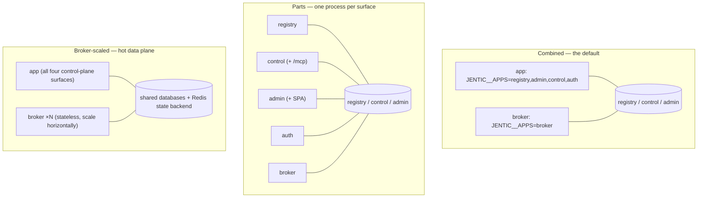

# Composition and processes

How one Python package becomes the processes you deploy: what happens between
`python -m jentic_one` and a serving FastAPI app, which surfaces share a
process, and which background work rides along.

## Boot sequence

```
python -m jentic_one
  └─ __main__.py        load_config() → configure logging/tracing/metrics
       └─ Context(config, allowed_dbs=…)      # DB gate computed from JENTIC__APPS
            └─ wiring.build_default_container(ctx)   # cross-surface seams
                 └─ app factory                       # per-surface or combined
                      └─ uvicorn.run(app)             # server.workers: 1 (default)
```

- **`__main__.py`** owns process concerns: config loading, observability
  setup, the `create-admin` first-run subcommand, the guard that disables
  `server.reload` on a SQLite admin DB (a single-file DB cannot take multiple
  writer processes), and the multi-worker launch (see
  [Multiple worker processes](#multiple-worker-processes-serverworkers)).
- **`Context`** ([`shared/context.py`](../../src/jentic_one/shared/context.py)) carries config plus lazily-opened
  database handles, gated by `allowed_dbs` (below).
- **`wiring.py`** is the composition root (see
  [surfaces and layering](surfaces-and-layering.md)); it builds the
  `AppContainer` — the DI seam carrying an optional injected `Broker`, extra
  routers, extra installers, and extra lifespans. The enterprise overlay and
  other downstream packages extend the system here, not inside surfaces.
- **The app factories** ([`shared/web/app_factory.py`](../../src/jentic_one/shared/web/app_factory.py)) assemble either one
  standalone surface app (`SURFACE_MODULES[surface].create_app`) or a
  combined app that includes every selected surface's routers in one shared
  root namespace — only the per-surface health routers carry a prefix
  (`/registry/health`, `/control/health`, …); business routes such as
  `/apis` and `/credentials` are served unprefixed.

## `JENTIC__APPS` selects the surfaces

One image, one package, any shape: the comma-separated `JENTIC__APPS`
environment variable decides which surfaces a process serves. Two rules are
enforced at boot:

- **The broker runs alone.** `_build_app` raises if `broker` appears with any
  other surface. The data plane holds decrypted secrets in memory during
  injection; keeping it in its own process keeps that memory out of the
  control plane and lets the two scale independently.
- **Databases are gated per shape.** `Context` only opens the databases the
  surface set needs. Each surface implies its own DB, widened by
  `SURFACE_DB_DEPS` in `__main__.py`: `broker` needs all three (resolve
  against registry, credentials from control, audit into admin); `auth`
  needs admin + control; standalone `control`/`registry` need admin (their
  local auth verifier resolves API keys and permissions there); and a
  control shape with MCP enabled needs registry (the `/mcp` search tools
  call registry services in-process). Touching a DB outside the gate raises
  immediately, so a mis-deployed process fails at boot.

## Deployment topologies



- **Combined** — two containers: everything except the broker in one
  process, the broker in the other. What
  [`deploy/`](../../deploy/README.md)'s compose files and the Helm chart's
  default values produce.
- **Parts** — each surface standalone, fronted by a gateway that routes by
  path prefix. Standalone apps serve at root (`/health`, not
  `/registry/health`); the combined app keeps the per-surface health
  prefixes so the probes don't collide. Agent-discovery documents
  (`/llms.txt`, `/skills/*`) are mounted on every standalone surface so a
  split deployment still serves them.
- **Broker-scaled** — brokers are stateless; run several behind a load
  balancer. Set `broker.resilience.backend.backend` to `redis` (and give
  every replica the same `broker.resilience.backend.redis_url`) so rate
  limits, circuit breakers, and idempotency records are shared across
  replicas. The redis client is an optional extra
  (`pip install jentic-one[redis]`), not part of the published container
  image — scaling out on that image means building your own with the extra.

## Multiple worker processes (`server.workers`)

By default `python -m jentic_one` serves from one process, so a broker (or
app) container uses at most one CPU core. Set `server.workers`
(`JENTIC__SERVER__WORKERS`) above 1 to have uvicorn run that many worker
processes behind one listening socket:

```
python -m jentic_one          # supervisor: load_config() + validation only
  └─ run_workers("jentic_one.__main__:create_app", workers=N)   # uvicorn Multiprocess
       ├─ worker 1: create_app() → load_config() → Context → app → lifespan
       ├─ worker 2: …
       └─ worker N: …
```

The supervisor builds no app. Each worker is a spawned process that re-imports
`jentic_one.__main__` and builds its own app through `create_app`, re-reading
config from the config file (`JENTIC_CONFIG_FILE`) and `JENTIC__*` environment
it inherits when it spawns. Config therefore has to be re-readable: nothing
set in the supervisor's memory reaches a worker, and a worker respawned after
a crash or `SIGHUP` runs on the file and environment as they are then. The
bind (`server.host` / `server.port`) is the same in both modes; no other
uvicorn option is set. `server.workers` is capped at 64.

**Startup failures exit the container.** The supervisor
([`shared/uvicorn_workers.py`](../../src/jentic_one/shared/uvicorn_workers.py))
is uvicorn's own `Multiprocess` with one change: a worker that dies before
it starts serving stops every worker, and the process exits with code 3,
as a single-worker run does. That covers an unreachable database, a bad
encryption keyset, the redis backend on an image without the `[redis]`
extra, a config edit that no longer validates when a worker respawns, and a
worker killed by a signal during boot (most often the out-of-memory killer
when the memory limit was not raised for N workers). Each worker reports
when it starts serving, so the supervisor does not rely on the exit code.
Docker's `restart:` policy and Kubernetes' crash-loop backoff then apply.
(Plain `uvicorn --workers` respawns such a worker every half second for
ever, and the container stays `Running`.) A worker that dies after it
served is respawned as usual.

What `server.workers > 1` refuses, and why:

| Refused | Where | Why |
| ------- | ----- | --- |
| Any database on the `sqlite` backend | config validation | One SQLite file serialises writers behind a single lock; N processes of request handlers and job pollers contend into `database is locked`, and an in-memory SQLite DB is not shared at all. Use PostgreSQL. Every database is checked, including ones the process's surfaces do not open. |
| `server.reload: true` | config validation | uvicorn's reloader supervises exactly one worker. |
| `broker.resilience.backend.backend: memory` when the process runs the **auth** surface | config validation | The login CSRF nonce, the consent handle, the OAuth rate limits and the JWT-bearer `jti` replay record live on this backend. On `memory` each worker has its own copy, and the next request can reach any worker (keep-alive lasts 5 s, and a load balancer spreads requests anyway): a login or consent step answered by another worker fails, and a replayed assertion is accepted there. |
| `broker.resilience.backend.backend: memory` when the process runs the **broker** surface with `broker.idempotency.enabled`, `broker.resilience.rate_limit.enabled` or `broker.resilience.circuit_breaker.enabled` (all on by default) | config validation | `Idempotency-Key` claims would not stop a retry that lands on another worker from running the upstream call again (a double POST), and rate-limit buckets and breaker counters would multiply by N. |
| `broker.resilience.backend.backend: memory` when the process runs the **control** surface | config validation | The per-actor connect-flow rate limits (the `POST /integrations:connect` / `:confirm` bucket and the MCP `request_connection` tool's) live on this backend. On `memory` each worker has its own buckets, so an actor gets N times the limit and the cap no longer protects the platform's vendor quota. |
| An unset `admin.auth.jwt_secret`, `admin.invite.pepper` or `credentials.connect.state_secret` that a surface of the process reads | config validation | Outside production an unset secret is generated per process, so each worker would mint its own: a session JWT, invite token or connect `state` signed by one worker would fail on the next. A broker reads none of the three, so it is not affected. |
| A one-shot config source (`JENTIC_CONFIG_FILE` on a pipe or `/dev/fd`) | `_serve`, before workers start | The supervisor drained it; the workers cannot re-read it. |

The fix for every shared-state row is
`broker.resilience.backend.backend: redis` with
`broker.resilience.backend.redis_url`
(`JENTIC__BROKER__RESILIENCE__BACKEND__BACKEND=redis`,
`JENTIC__BROKER__RESILIENCE__BACKEND__REDIS_URL`), or `server.workers: 1`.
**The published container images do not include the `[redis]` extra**, so on
them `server.workers > 1` is available only to processes that run neither
the auth nor the control surface nor a broker with those three features on:
in practice the registry/admin surfaces, or a broker with idempotency, rate
limiting and the circuit breaker all disabled. Build your own image with
`jentic-one[redis]` to run more workers for auth, control or a default broker
(shipping the extra in the published images is tracked in #1786).

Each worker runs the full lifespan, so everything a process owns is
multiplied by N. That is the same model as running N replicas with one
worker each, and these are its consequences:

- **Memory multiplies by N.** Each worker is a full Python interpreter with
  the whole package imported, plus its own pools and caches, and the
  supervisor is one more process. Raise the container's memory limit
  roughly N× along with its CPU limit (the broker chart's default 256Mi
  limit fits one worker).
- **Background loops run in every worker.** Each worker's `WorkerLoop`
  polls for jobs. Claiming is safe under concurrent pollers on PostgreSQL:
  the claim is a single `UPDATE … WHERE id = (SELECT … FOR UPDATE SKIP
  LOCKED LIMIT 1) RETURNING`, so two pollers never claim the same job
  and a job left `RUNNING` by a dead worker is reclaimed after its
  visibility deadline. The scanners are already replica-safe: the
  credential-expiry scanner dedupes on persistent markers, the connect-poll
  scanner leases rows with `SKIP LOCKED`, and the catalog update scanner
  de-phases its sweeps (a rare duplicate `catalog.update_available` event is
  tolerated, as it is across replicas). With telemetry on, every worker
  emits its own `instance_booted` event, so one start reports N boots.
- **Metrics are per process.** There is no multiprocess aggregation. With
  `observability.metrics.exporter: prometheus`, a `/metrics/` scrape is
  answered by whichever worker accepts the connection and shows only that
  worker's series, so counters appear to jump between scrapes (the
  supervisor logs `prometheus_metrics_per_worker` at start). Use the `otlp`
  exporter (the OpenTelemetry SDK gives each process its own
  `service.instance.id`, so worker series stay distinct at the collector),
  or run one worker per container and scale replicas.
- **Limits and pools are per process.** `broker.resilience.max_in_flight`,
  the readiness saturation threshold, the outbound HTTP pool and each
  database's `pool_max` apply per worker: a broker with
  `server.workers: 4` admits 4× `max_in_flight` and opens up to
  4× `pool_max` connections to each database. Size PostgreSQL's
  `max_connections` (or a pooler) for it.
- **MCP config-registration events are deduped per process.** The
  once-a-day `mcp.config_registered` event per (actor, runtime) is deduped
  in process memory, so N workers can record it up to N times a day. It is
  an adoption-funnel event, not a limit.
- **Provider config changes reach one worker.** An admin write to a
  credential provider config rebuilds the provider registry only in the
  worker that served it (see `Context.refresh_providers`). In a process that
  also runs control or the broker, the other workers keep the registry they
  loaded at boot until they restart, so a connect or credential-refresh call
  they answer uses the previous provider config (the supervisor logs
  `provider_config_refresh_per_worker`). Restart the deployment after
  changing provider configs. This is the same gap that separate admin and
  control processes have (tracked in #1785).
- **AWS Marketplace contract checks are de-phased.** With
  `entitlement.enabled` and `pricing_model: contract`, every worker runs
  its own `CheckoutLicense` probe at boot and on each refresh, and a
  contended seat answers like a missing license. Each worker waits a random
  0 to N seconds (at most 10) before each probe, so N workers do not
  probe in lockstep on a low-seat contract. Readiness can be delayed by up
  to that offset.
- **Caches are per process.** The broker's token/API-key resolve cache,
  its credential-derivation and rule caches, and their single-flight
  coalescing are per worker, so a cold miss costs up to one lookup per
  worker and a revocation is bounded by each worker's cache TTL — the
  same as across replicas.
- **What is shared.** Anything in the database: job claims, login lockout
  (`failed_login_count` / `locked_until`), tokens, sessions and audit.
  With the redis backend, everything the auth, broker and control surfaces
  keep on it, including the JWT-bearer `jti` replay record and the connect
  rate limits. MCP's `/mcp` endpoint
  is stateless, so it needs no session affinity.

## Lifespan ordering

`create_surface_app` wires one lifespan per process, and teardown order is
load-bearing:

1. **Startup:** `ctx.startup()` → DB instrumentation → telemetry → the
   surface's own `extra_lifespan` (the broker opens its shared outbound
   `httpx.AsyncClient` here) → container-injected lifespans (the `/mcp`
   session manager) → background workers.
2. **Shutdown**, with a drain step first: the broker's admission gate
   reports unready (so the load balancer deregisters the instance) →
   scanners stop → the job worker drains → telemetry flushes →
   `ctx.shutdown()` → container-injected lifespans exit in reverse → the
   surface lifespan closes the shared HTTP client. Draining the worker
   *before* closing the client matters: an async execution mid-flight must
   finish over a live connection pool.

## Background work

Four loops start inside the lifespan:

| Loop | Runs when | Job |
| ---- | --------- | --- |
| `WorkerLoop` ([`shared/jobs/worker.py`](../../src/jentic_one/shared/jobs/worker.py)) | the admin DB is reachable and a handler registered | Claims queued jobs from the admin DB's jobs table. The `IMPORT` handler registers only on registry shapes; the `EXECUTION` handler only where the broker's upstream executor exists. A broker process therefore never claims import jobs, and an app process never claims executions. |
| `CredentialExpiryScanner` | control shapes | Emits expiry warnings for credentials nearing their end date. |
| `CatalogUpdateScanner` | registry shapes | Watches imported APIs' sources for upstream changes and raises update-available notifications. |
| `TelemetryFlushLoop` ([`shared/telemetry/loop.py`](../../src/jentic_one/shared/telemetry/loop.py)) | `telemetry.enabled` (off by default in code, on in the shipped install examples) and the admin DB is reachable | Drains the telemetry queue and POSTs event batches (the catalog scanner also egresses, to the tracked spec sources); drains once more on shutdown. |

The gate is the surface set (`enabled_apps`), not which DBs happen to be
reachable: the broker is granted the registry DB for its synchronous resolve
path, but it is not the registry surface, so it must not race the control
plane for import jobs.

## Related

- [Broker execution](broker-execution.md) — what the broker process does
  with the resources this lifespan hands it.
- [Data model](data-model.md) — the three databases the gate above controls.
- [`docs/installation/helm.md`](../installation/helm.md) and
  [`deploy/README.md`](../../deploy/README.md) — how these shapes are
  expressed in Helm values and compose files.
