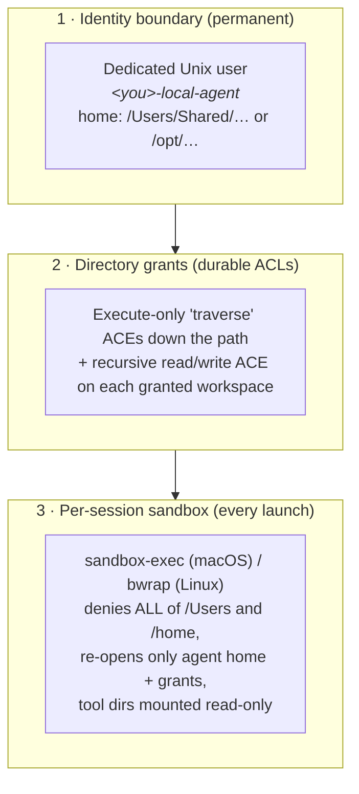
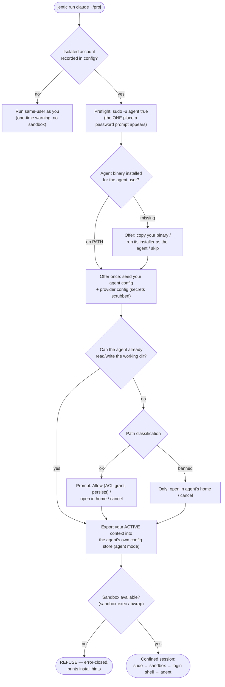

# Run coding agents in isolation — `jentic run`

This is the operator guide to the **local-agent sandbox**: launching a CLI coding
agent (Claude Code, Codex, Cursor's `cursor-agent`, Hermes) as its **own
unprivileged Unix user**, so a compromised or prompt-injected agent cannot read
your SSH keys, browser session, cloud credentials, or the Jentic One credential
store.

It covers the flow and day-to-day usage with examples. For the security design
and rationale, see [`docs/security/same-host/`](../security/same-host/README.md);
for the generated per-flag reference, open `/app/docs` on your deployment
(Reference → CLI).

- [The mental model](#the-mental-model)
- [Quickstart](#quickstart)
- [What `jentic setup` sets up](#what-jentic-setup-sets-up)
- [The `jentic run` flow](#the-jentic-run-flow)
- [Cookbook](#cookbook)
- [Where state lives](#where-state-lives)
- [Tearing it all down — `jentic reset`](#tearing-it-all-down--jentic-reset)
- [Troubleshooting](#troubleshooting)
- [Platform support](#platform-support)

## The mental model

Three mechanisms stack, and all three must hold for a session to start:



The result, from the agent's point of view:

| Path | Access | Why |
| ---- | ------ | --- |
| Agent's own home (`/Users/Shared/<agent>` / `/opt/<agent>`) | ✅ read/write | Its workspace-of-last-resort; you keep an inherited read/write ACL into it |
| Each directory you granted | ✅ read/write | Recursive inherited ACL + sandbox re-open |
| The agent's own `~/.local/bin` | ✅ read + execute, ❌ write | So it can't rewrite its own launched binary |
| System / Homebrew tool dirs (`/usr/bin`, `/opt/homebrew/bin`, …) | ✅ read + execute, ❌ write | Shared tools without letting the agent replace them |
| **Your home** — everything not granted | ❌ | Sandbox denies `/Users` + `/home` wholesale |
| `~/.ssh`, `~/.aws`, `~/.jentic`, keychains, browser profiles | ❌ **never grantable** | Hard-banned: the grant prompt offers no "grant anyway" |
| System trees (`/etc`, `/usr`, `/var`, `/`) | ❌ not grantable | Hard-banned |

Two honest limits (details in the
[security docs](../security/same-host/local-agent-isolation.md)): the boundary
protects **you from the agent** — it does not partition the agent from itself
(anything seeded into the agent's home is readable by it), and it does **not**
restrict network egress.

## Quickstart

```bash
# 1. One-time: onboard. After you pick your agent, setup offers to isolate
#    it behind a dedicated Unix user (asks before any sudo runs).
jentic setup

# 2. Every session: launch the agent, confined, in the project you name.
jentic run claude ~/projects/my-app

# 3. Done with the whole setup? Tear it down (prompts before anything destructive).
jentic reset
```

A first `jentic run` in a directory the agent can't reach looks like this:

```text
$ cd ~/projects/my-app && jentic run claude
⚠ Agent alice-local-agent has no access to /Users/alice/projects/my-app.
How should the session reach this directory?
  Open in the agent's home instead
> Allow the agent read/write here (adds an inherited ACL)
  Cancel

  Granted (persists across sessions; `jentic run claude --list-grants` to review).
  This is OS-level access only — the agent still runs its own workspace-trust prompt.
Launching claude as alice-local-agent in /Users/alice/projects/my-app (confined) ...
```

From then on that directory opens without a prompt.

> **No isolated account?** `jentic run` still works: it launches the agent
> directly **as you** (no sandbox) and prints a one-time warning telling you
> so. Run `jentic setup` to get the isolated setup.

## What `jentic setup` sets up

`jentic setup` takes a fresh machine to ready: register an agent identity
with your Jentic install, write the CLI-usage skill into your agent runtime, and
— the part this guide is about — offer to isolate the agent. The isolation step
is **sudo-last**: it asks *"Create a dedicated user account for your local
agent? (requires sudo)"* before any privileged command runs, so declining never
triggers a password prompt.

Opting in shows one prefilled, editable form:

| Field | Default | Notes |
| ----- | ------- | ----- |
| Agent account name | `<you>-local-agent` | Validated as a safe Unix username |
| Agent home directory | `/Users/Shared/<name>` (macOS), `/opt/<name>` (Linux) | Always outside every human home |
| Copy your agent config? | Yes when found | Names the exact files ("Will copy: ~/.claude, ~/.claude.json") |
| Copy your provider config? | Yes when detected | AWS Bedrock → `~/.aws`; Google Vertex → `~/.config/gcloud` |
| Passwordless launch? | Yes | Scoped sudoers rule to *become the agent user* — never root |

Then, if your agent has a record of trusted workspaces (Claude Code's
`~/.claude.json` projects you accepted the trust dialog for), setup offers
them as a pre-selected multiselect — **"Bring your workspaces over"** — so you
don't re-grant each project by hand on first run. Banned paths (see
[the grant model](#granting-directories)) are never offered.

Non-interactive setup:

```bash
jentic setup --url https://jentic.example.com --operator claude --yes
jentic setup --skip-skill        # identity only
jentic setup --dry-run           # describe everything, change nothing
```

Prerequisites are checked **before** the first sudo. If something is missing
(e.g. `bwrap` on a minimal Linux), setup prints the exact install command
for your package manager and offers to continue same-user — a missing dependency
never blocks the identity/skill provisioning you came for.

## The `jentic run` flow

```
jentic run <agent> [path] [flags] [-- <agent-args>...]
jentic run -- <agent> [agent-args...]
```

`<agent>` picks the **binary** (`claude`, `codex`, `cursor`, `hermes`) — never
an account or identity. There is one shared agent account; identity comes from
your **active context**, exported into the agent's home at every launch.

What a launch does, in order:



Details worth knowing:

- **One password prompt.** All privileged steps go through the same `sudo -u
  <agent>`; the preflight is where you're asked (or nothing, with the
  passwordless rule). A declined password is reported as a sudo problem, never
  misdiagnosed as "agent not installed".
- **Binary provisioning.** Single-file agents (claude, codex) default to
  copying your binary into the agent's `~/.local/bin`; installer-based agents
  (cursor, hermes) run their documented installer *as the agent user*. Copying
  carries the binary, never your credentials — the agent authenticates its own
  tools on first launch.
- **Config seeding is opt-in, once, and never clobbers.** It only runs while
  the agent has no config of its own. Discrete credential files inside seeded
  trees (Codex's `~/.codex/auth.json`, Hermes's `~/.hermes/.env`) are scrubbed
  after the copy: the agent inherits your *settings* but authenticates as
  itself.
- **Confinement is required.** If the machine can't sandbox the session,
  `jentic run` refuses (`CONFINEMENT_UNAVAILABLE`) rather than silently running
  unconfined — and prints the per-dependency fix.
- **Your environment doesn't leak.** The launch forwards only terminal/locale
  variables (`TERM`, `LANG`, …) and explicitly unsets SSH/GPG agent handles, so
  the agent can't ride your forwarded ssh-agent.

## Cookbook

### Launching

```bash
jentic run claude                       # current directory (prompts to grant if needed)
jentic run claude ~/projects/api        # explicit working directory
jentic run claude --home                # start in the agent's own home — nothing to grant
jentic run codex ~/work/site            # any runnable agent: claude, codex, cursor, hermes
```

### Forwarding arguments to the agent

Everything after `--` goes to the agent binary **verbatim** (like
`cargo run --` / `kubectl exec --`). Two forms:

```bash
# Trailing --: jentic's own args (agent, optional path) come first.
jentic run claude -- --model opus -p "review this"    # runs: claude --model opus -p "review this"
jentic run claude ~/work/api -- --resume              # forwards --resume, workdir ~/work/api

# Leading --: the whole agent command follows the separator. Nothing after it is
# parsed by jentic, so agent flags can never collide with jentic flags.
jentic run -- claude --resumeSessionId=1234
```

The leading form takes no path argument (the working directory is the current
one) — use the trailing form when you need to pass a path. Forwarded arguments
run inside the same confined session; they never widen the sandbox.

### Granting directories

Grants are **persistent** (they're filesystem ACLs, not per-session), so review
them occasionally:

```bash
jentic run claude --list-grants          # what can the agent reach?
jentic run claude --grant  ~/work/api    # grant without launching
jentic run claude --revoke ~/work/api    # revoke (leaf access drops immediately)
```

```text
$ jentic run claude --list-grants
Directory grants
  agent: claude
  user:  alice-local-agent
  dir:   /Users/alice/projects/my-app
  dir:   /Users/alice/work/api

To take a directory away: `jentic run <agent> --revoke <dir>` (`--list-grants` to review).
```

What you can and can't grant:

| You ask for | Verdict | What happens |
| ----------- | ------- | ------------ |
| `~/projects/my-app` | ✅ fine | Allow / open-in-home / cancel prompt |
| `~` (your home) | ⚠ soft ban | Not grantable itself — grant a subdirectory instead |
| `~/.config` | ⚠ soft ban | Holds credential children; grant e.g. `~/.config/nvim` instead |
| `/Users/bob` | ⚠ soft ban | Another human's home root |
| `~/.ssh`, `~/.aws`, `~/.jentic`, `~/.kube`, browser profiles, keychains | ⛔ hard ban | Path **and every descendant** refused — no "grant anyway" exists |
| `/etc`, `/usr`, `/var`, `/` | ⛔ hard ban | System trees |

Symlinks are resolved before classification, so a link into a banned tree is
caught. On macOS the check is case-insensitive (`~/.SSH` is still `~/.ssh`).

### Non-interactive / scripted use

```bash
jentic run claude --yes                  # take the safe default at every prompt
                                         # (never grants a flagged-dangerous dir)
jentic run claude ~/proj --allow-dir     # pre-answer the grant prompt with "Allow"
jentic run claude --no-allow-dir         # never grant; open in the agent's home
jentic run claude --seed-config          # copy your agent config without prompting
jentic run claude --no-seed-config       # never copy it
```

`--allow-dir` still hard-refuses a banned directory — flags can't override the
boundary.

### Per-agent notes

| Agent | Binary | Provisioning default | Seeded config | Secrets scrubbed after seeding |
| ----- | ------ | -------------------- | ------------- | ------------------------------ |
| `claude` | `claude` | copy your binary | `~/.claude`, `~/.claude.json` | — (key is embedded in the config Claude needs) |
| `codex` | `codex` | copy your binary | `~/.codex` | `~/.codex/auth.json` |
| `cursor` | `cursor-agent` | run its installer | `~/.cursor` | — |
| `hermes` | `hermes` | run its installer | `~/.hermes` | `~/.hermes/.env` |

`cursor` here is the **headless `cursor-agent` CLI** — the Cursor GUI cannot run
under a separate Unix account (see
[GUI IDEs](../security/same-host/local-agent-isolation.md#gui-ides-cursor--vs-code)
for the Remote-SSH pattern). `generic` is a skill-only target for
`jentic skill`; `jentic run generic` is refused with a pointer.

### Cloud LLM providers (Bedrock / Vertex)

If your Claude Code setup points at a cloud provider, `jentic run` detects it
from `~/.claude/settings.json` and offers to seed *that provider's* config:

| `settings.json` env | Provider | Seeded |
| ------------------- | -------- | ------ |
| `CLAUDE_CODE_USE_BEDROCK=1` | AWS Bedrock | `~/.aws` (config + profiles; **not** the cached SSO token) |
| `CLAUDE_CODE_USE_VERTEX=1` | Google Vertex | `~/.config/gcloud` + any `GOOGLE_APPLICATION_CREDENTIALS` file |
| neither | Anthropic API | nothing extra |

Both seed prompts carry the same warning: seeded credentials are readable by the
agent. Prefer fronting the provider with an LLM proxy (e.g. LiteLLM) and a
revocable virtual key, so nothing sensitive comes to rest in the agent account.

### The agent's tools

- The agent's `~/.local/bin` is prepended to its PATH (where its binary lands).
- Your **world-readable** tool dirs (Homebrew's `/opt/homebrew/bin`,
  `/usr/local/bin`, `/snap/bin`) are appended to the agent's PATH so `git`,
  `jq`, `rg`, `node` etc. just work — read-only inside the sandbox.
- Tool dirs **under your home** (`~/.cargo/bin`, `~/go/bin`, npm globals) are
  deliberately *not* shared — the agent can't reach into your home. Install
  those in the agent account, or use the binary-copy route.

### Container mode (experimental) — `jentic run --container`

`--container` runs the agent in a Docker container instead of as the agent
user. No agent account, grant or sandbox profile is involved: the container is
the isolation.

```bash
# Build the three images once, from a jentic-one checkout (they are not published):
docker build -f deploy/docker/run-agent.Dockerfile -t jentic-run-agent:local cli
docker build -f deploy/docker/run-bridge.Dockerfile -t jentic-run-bridge:local deploy/docker
docker build -f deploy/docker/run-proxy.Dockerfile -t jentic-run-proxy:local cli

jentic run --container claude ~/src/project
```

- **The work folder** is bind-mounted read-write at its host path and is the
  agent's working directory. The same folders the grant policy bans (a home
  root, `~/.ssh`, `~/.config`, system trees) are refused.
- **Jentic** stays at the active context's URLs (`http://127.0.0.1:8000` and
  the broker's port), so tokens and audiences match. The context must be on
  this machine's loopback. The active context is exported into the session's
  home volume, mode `agent`, as on the agent-user path.
- **Egress goes through the session's proxy** (`--container-egress proxy`, the
  default). The agent's only route out is a proxy sidecar
  (`HTTPS_PROXY=http://jentic-run-<session>-proxy:3128`), which:
  - **tunnels** the agent's LLM provider without decrypting it: for Claude
    Code `api.anthropic.com`, `platform.claude.com`, `statsig.anthropic.com`
    and `console.anthropic.com`, plus the Bedrock and AWS SSO hosts when
    `CLAUDE_CODE_USE_BEDROCK` is set, or the Vertex hosts when
    `CLAUDE_CODE_USE_VERTEX` is set (with `CLOUD_ML_REGION`);
  - **governs** the vendor APIs whose CLI facade this Jentic serves
    (`github.com`, `api.cloudflare.com`, `amazonaws.com`, see
    `jentic cli list`): `gh api /user`, `curl https://api.github.com/…`, the
    AWS SDKs and so on run as usual, but each call goes to the broker
    (`/_facade/proxy/https://<host>/<path>`) under the agent's rules, with
    the vendor credential injected there. No vendor credential enters the
    container. Calls are recorded under a session invocation token
    (`command_title` `session`) that `jentic run` mints when the session
    starts, renews while it runs and revokes when it ends. A command can
    attribute its own calls with `HTTPS_PROXY=http://<cit_ token>:x@<proxy>:3128`.
    Jentic's refusals come back in the vendor's error shape;
    git to `github.com` (clone, fetch, push) is governed the same way, by
    the agent's git rules (see [git in container mode](#git-in-container-mode));
  - **refuses** everything else, plain-HTTP proxying included, with a 403
    (logged by the proxy). On `github.com` only git is relayed: its web pages
    and Git LFS are refused.

  Trust for the governed hosts comes from a per-session CA the proxy creates
  in memory, name-constrained to those domains (and to no IP address), and
  handed to the agent's TLS clients through `SSL_CERT_FILE`,
  `REQUESTS_CA_BUNDLE`, `NODE_EXTRA_CA_CERTS`, `GIT_SSL_CAINFO`,
  `AWS_CA_BUNDLE` and `CURL_CA_BUNDLE`. It is never installed in any trust
  store. `--container-egress none` gives the agent no route at all: its calls
  to its LLM provider and to vendor APIs fail.
- **Hardening:** an unprivileged uid, every capability dropped,
  `no-new-privileges`, a read-only root filesystem, no Docker socket.
- **Config seeding** writes a fresh `~/.claude.json` (onboarding done, the work
  folder trusted). With `--seed-config` (or a yes at the prompt) it also copies
  your theme, model, permissions and `CLAUDE.md`. Hooks, the status line, key
  helpers, `env`, plugins, credentials and login state are never copied, nor is
  any provider config (`~/.aws`, gcloud), unless you opt in with
  `--container-share-provider-credentials` (see below).
- **Teardown:** the session's invocation tokens are revoked, and the agent,
  bridge and proxy containers, networks and volumes are removed when the
  session ends, on exit, Ctrl-C or SIGTERM. If the client is killed
  outright, the next `jentic run --container` removes the leftovers. The
  agent's exit code is passed through.
- **Native Linux Docker:** the bridge that carries the Jentic ports runs in
  the host's network namespace (the agent never does), so a Jentic bound to
  `127.0.0.1` is reachable. Under Docker Desktop and OrbStack it uses
  `host.docker.internal`. The agent runs with your uid on a native engine, so
  files it writes are yours; under Docker Desktop it runs as uid 1000 and
  Desktop maps ownership to you.

| Flag | Meaning |
| ---- | ------- |
| `--container` | Run in a container (experimental). Refused together with the agent-user flags (`--home`, `--allow-dir`, `--grant`, …). |
| `--container-image <ref>` | Agent image (default `jentic-run-agent:local`). |
| `--container-egress proxy\|none` | Egress mode (default `proxy`; see above). |
| `--container-share-provider-credentials` | For local testing: share your own LLM-provider login with the agent (see below). Off by default; asks for confirmation unless `--yes`. |

A Docker engine that is unreachable, a missing image, a remote context or
file-less mode (`JENTIC_BEARER_TOKEN`) fail closed with
`CONFINEMENT_UNAVAILABLE` (exit 1) and the fix to apply. With the proxy, so do
a broker URL that is not plain HTTP on the loopback, a control plane that
cannot list its CLI facades, an agent that cannot mint invocation tokens (it
needs `capabilities:execute` and its own access token, not an API key) and a
proxy that does not publish this session's CA in time. `jentic run` never
falls back to an unisolated launch or a looser egress.

#### git in container mode

git inside the container clones, fetches and pushes over HTTPS to the real
`https://github.com/<owner>/<repo>.git` URL, with no credential helper, token
or `insteadOf`: the proxy relays git's requests to the broker, which checks
the agent's git rules per repository and ref and injects the GitHub
credential itself
([Governed git](../architecture/broker-execution.md#governed-git)). SSH
remotes (`git@github.com:…`) do not work: only HTTPS leaves the container.
`jentic cli list` shows `git` among GitHub's protocols while the deployment
serves it (`cli_facades.git.enabled`, on by default with the GitHub facade).

The agent needs a credential that covers the built-in git API
(`github-com/github-git`) and git rules on its binding. The GitHub profile
credential `jentic connect github` creates covers git together with the REST
and GraphQL APIs ([CLI profiles](#cli-profiles)); only its `git` rules decide
a git request. For a credential of git alone, the operator adds a vendor entry
that targets the git API (same OAuth app as the `github` entry;
`config/local.yaml` ships it):

```yaml
vendors:
  entries:
    github-git:
      vendor: github.com/github-git    # the built-in git API, not a catalog API
      display_name: GitHub (git)
      flows:
        - kind: device_authorization
          client_id: "<your GitHub OAuth app client id>"
          authorization_endpoint: https://github.com/login/device/code
          token_endpoint: https://github.com/login/oauth/access_token
      scopes:
        - {name: repo, classification: write, default: true}
```

The agent then asks for it, with the rules it needs (or a preset, see
[CLI profiles](#cli-profiles): `--preset push_branches --preset-param
repo=octo-org/app --preset-param branches='agent/*'`); the human approves both
in the browser:

```bash
jentic connect github-git --scopes repo --wait --rules '[
  {"effect": "allow", "match_mode": "git", "path": "fetch:octo-org/app"},
  {"effect": "allow", "match_mode": "git", "path": "push:octo-org/app:refs/heads/agent/*"}
]'
```

That binding may clone and fetch `octo-org/app` and push to `agent/*`
branches (create or fast-forward); a force-push, a push to any other branch
or tag, and every other repository are refused, and git prints
`! [remote rejected] <ref> (jentic: <reason>)`. A git request with no git
binding is refused with the `jentic connect github-git` command to run.

A vendor-wide credential (vendor `github.com`, no API name, entered by hand)
also covers git, but it covers every GitHub API of the deployment, including
ones imported later, under one rule list: REST, GraphQL and git rules still
each decide only their own kind of request, but a broad REST rule then
reaches every GitHub REST API. Prefer the profile credential (`jentic connect
github`) or the per-API `github-git` credential.

#### Testing with your own provider login

Out of the box the agent in the container has no LLM credential: container
mode never copies one in, so Claude Code there has to log in on its own. To
try container mode with the login your own Claude Code already uses (AWS
Bedrock, say), opt in explicitly:

```bash
jentic run --container --container-share-provider-credentials claude ~/src/project
```

`jentic run` prints a warning and asks you to confirm (`--yes` confirms up
front; without a terminal and without `--yes` it refuses). What the agent gets
depends on the provider your `~/.claude/settings.json` env block (or your
shell) selects:

| Provider | Mounted read-only | Passed |
| -------- | ----------------- | ------ |
| Bedrock (`CLAUDE_CODE_USE_BEDROCK`) | `~/.aws` → `/home/agent/.aws` | `CLAUDE_CODE_USE_BEDROCK`, `AWS_PROFILE`, `AWS_REGION`, `AWS_DEFAULT_REGION` |
| Vertex (`CLAUDE_CODE_USE_VERTEX`) | `~/.config/gcloud` → `/home/agent/.config/gcloud`; a `GOOGLE_APPLICATION_CREDENTIALS` file → `/run/jentic-provider/google-application-credentials.json` | `CLAUDE_CODE_USE_VERTEX`, `CLOUD_ML_REGION`, `ANTHROPIC_VERTEX_PROJECT_ID`, `GOOGLE_APPLICATION_CREDENTIALS` (the mounted copy) |
| Anthropic API (default) | nothing | `ANTHROPIC_API_KEY`, from your shell only (never from a file) |

For every provider the `ANTHROPIC_*MODEL*` variables,
`CLAUDE_CODE_MAX_OUTPUT_TOKENS` and `MAX_THINKING_TOKENS` are passed too. A
value in your settings wins over your shell's, as in Claude Code itself. The
variables go into the agent's own `~/.claude/settings.json` env block in the
session volume; nothing else from your settings env is passed, and hooks,
`awsAuthRefresh` and the other helpers are never copied. A claude.ai
subscription login (kept in your keychain) is not shared.

With Bedrock and an IAM Identity Center (SSO) profile:

- The agent's AWS SDK reads your profile and the SSO token cache in
  `~/.aws/sso/cache` from the read-only mount. When it refreshes a token it
  keeps the new one in memory (the SDK ignores a failed cache write), so the
  mount does not need to be writable.
- `awsAuthRefresh` runs a command on your machine, so it is not run in the
  container. When your SSO session lapses, run `aws sso login` (or your
  usual refresh) on the host. The mount is live, so the agent sees the new
  token; if Claude Code keeps a failed login, restart the session.
- The egress proxy tunnels Bedrock runtime (`bedrock-runtime.<region>.amazonaws.com`)
  and the SSO OIDC and portal hosts (`oidc.<region>…`, `portal.sso.<region>…`),
  chosen from the shared settings. Every other AWS host, `sts.*` included,
  stays governed through Jentic, so a profile that assumes a role through
  STS (`role_arn`/`source_profile`) or runs a `credential_process` does not
  work in the container; an SSO profile or static keys in `~/.aws` do.

Why it is not the default: container mode's guarantee is that the agent holds
no credential of yours and reaches vendor APIs only through Jentic. A shared
provider login breaks that for the provider: the agent can read the mounted
files (every profile and key in `~/.aws`, not only the one in use) and call
the provider as you, without Jentic governing, recording or limiting those
calls. The mounts are read-only and limited to the paths above; a `~/.aws`
or gcloud dir that is a symlink out of your home, to your home itself or
into another sensitive dir (`~/.ssh`, …) is refused. Use it on your own
machine, for testing.

## CLI profiles

Each vendor CLI Jentic governs has a **CLI profile**, a manifest shipped with
Jentic ([reference](../architecture/cli-profiles.md)). It declares the
vendor's APIs and where each comes from, how the Broker and the container
egress proxy route the CLI's calls, the environment `jentic <cli>` and `jentic
run --container` give the CLI, and rule presets. `jentic cli profiles` lists
them (`GET /cli-profiles`); `jentic cli list` shows what each served facade
wires.

The GitHub profile has three APIs. `jentic connect github` connects all three
at once: one device-flow sign-in, one stored grant (so one refresh token), one
credential covering exactly these APIs and no other GitHub API, and one
binding whose rules each apply to one API only:

| API | Source | Rules (`api_role`) | One-API connect |
| --- | ------ | ------------------ | --------------- |
| REST (`api.github.com`, `uploads.github.com`) | the public API catalog | path rules (`rest`) | — |
| GraphQL (`POST api.github.com/graphql`) | a spec shipped with Jentic | GraphQL rules (`graphql`) | `jentic connect github-graphql` |
| git (clone, fetch, push to `github.com`) | built into the Broker | git rules (`git`) | `jentic connect github-git` |

A call to one of the APIs is decided by that API's rules alone, and an API
with no rule of its own is denied: a REST path rule never lets a GraphQL
mutation or a git push through. `jentic connect github-graphql` and `jentic
connect github-git` still create a credential for that one API, if you want
one.

### Enabling GitHub end to end

1. Operator: switch the facade on and give the vendor entries your GitHub
   OAuth app (device flow enabled). `config/local.yaml` ships the `github`,
   `github-graphql` and `github-git` entries; set each `client_id`:

   ```yaml
   cli_facades:
     enabled: true
     vendors:
       github: {enabled: true, host: github.jentic.example.com}
   vendors:
     entries:
       github:         {vendor: github.com/api.github.com, ...}
       github-graphql: {vendor: github.com/github-graphql, ...}
       github-git:     {vendor: github.com/github-git, ...}
   ```

2. Operator (optional): put the APIs in place before any agent connects. The
   REST import runs as a job; the GraphQL spec is live at once; git needs
   nothing:

   ```bash
   jentic admin cli-profiles provision github
   ```

   Without this, the first connect for any of the three provisions the whole
   profile on demand.

3. Agent: ask for the profile with a preset; the human approves once in the
   browser and sees the concrete rules grouped per API:

   ```bash
   jentic connect github --scopes repo --preset read_and_push \
     --preset-param repo=octo-org/app --preset-param branches='agent/*' --wait
   ```

4. Agent: run the tools: `jentic cli run gh -- pr list` on the agent's machine
   (host-mode facade), or `gh`, `git` and `curl` as usual inside `jentic run
   --container`.

Presets expand server-side into rules for each API, tagged with its role
(`jentic connect github` asks for every parameter the preset's rules use; a
one-API connect only for that API's):

| Preset | REST | GraphQL | git |
| ------ | ---- | ------- | --- |
| `read_only` | `GET` everything | every query, no mutation | `fetch:<repo>` |
| `read_and_prs` | `GET` everything, open PRs, comment | queries, PR mutations; other mutations held | `fetch:<repo>` |
| `push_branches` | | | `push:<repo>:refs/heads/<branches>`; `force:` too with `--preset-param force=true` |
| `read_and_push` | `GET` everything | every query, no mutation | `fetch:<repo>` and `push:<repo>:refs/heads/<branches>` |

`--preset-param repo=` takes comma-separated `<owner>/<repo>` globs; repeating
the flag adds to the list. A preset's rules come after any `--rules` the agent
lists itself; with `jentic connect github` each `--rules` entry may name its
`api_role` (`rest`, `graphql`, `git`), and one that names none goes by kind (a
`git` rule to git, a `graphql` rule to GraphQL, any other to REST). The hard-deny lists (GraphQL mutations that grant access or
change protections, refs outside `refs/heads/` and `refs/tags/`) apply under
every preset.

## Where state lives

Everything jentic-owned is XDG on both sides (localagent keeps nothing in
`~/.jentic` — records written there by older releases are adopted into the XDG
file on the next `jentic run`/`jentic reset` write, or by `jentic migrate`):

| Location | Owner | Holds |
| -------- | ----- | ----- |
| `~/.config/jentic/agent-account.yaml` (yours) | you | The `agent_account:` record — account name, home, and the consolidated `granted_dirs` list — plus the one-time same-user notice flag. Paths and names only, no secrets. |
| `~/.config/jentic` + `~/.local/state/jentic` (yours) | you | Your V2 identity store: environments, identities, contexts, keys, tokens. |
| `<agent home>/.config/jentic` + `<agent home>/.local/state/jentic` | agent | A **minimal export of your active context** (one environment + identity + context, mode forced to `agent`), refreshed at every launch — so the `jentic` the agent runs resolves the same install and identity without flags, and can never drift onto a stale copy. |

The ACLs on disk are the source of truth for access; the `granted_dirs` list is
the recorded inventory that `--list-grants`, the sandbox profile, and `reset`
read. Because the list lives in *your* config tree — and `~/.config/jentic` is
itself hard-banned from grants and denied by the sandbox — the agent can't edit
its own access.

## Tearing it all down — `jentic reset`

```bash
jentic reset                        # full clean slate (interactive, typed confirmation)
jentic reset --force                # non-interactive; keeps the agent home
jentic reset --force --delete-home  # non-interactive; deletes the home too
```

Run it **as yourself**, not `sudo jentic reset` — it prompts for your password
only when it reaches the privileged steps. It surveys first and shows the full
plan (every ACL, file, and the account) before a typed `reset` confirmation, and
then removes, in order: the directory ACLs (leaf grants *and* the ancestor
traverse entries), the agent's own jentic identity (its exported keys and
tokens under `<agent home>/.config/jentic` and `<agent home>/.local/state/jentic`,
plus any legacy `<agent home>/.jentic`), the sudoers drop-in, the Unix account,
and finally your own jentic identity state.

The **agent's home is preserved by default** — re-owned to you so the agent's
work survives — with its jentic identity and any seeded agent/provider config
(`~/.claude`, `~/.aws`, `~/.codex`, …) cleared from it, so no credential
material outlives the account. Deleting the home takes a separate, explicit
confirmation. To remove a single context or identity instead of everything, use
`jentic context delete` / `jentic identity delete`.

## Troubleshooting

| Symptom | Cause | Fix |
| ------- | ----- | --- |
| `confined agent sessions aren't available on this machine` (`CONFINEMENT_UNAVAILABLE`) | No `sandbox-exec` (macOS) or missing `bwrap` / unprivileged user namespaces / `acl` package (Linux) | Run the printed install command, e.g. `sudo apt install bubblewrap acl`; userns: `sudo sysctl -w kernel.unprivileged_userns_clone=1`. `jentic run` never falls back to an unconfined session. |
| Password prompt on every launch | No passwordless rule installed | Re-run `jentic setup` and accept the passwordless-launch toggle, or enable Touch ID for sudo on macOS. |
| `agent account "…" does not exist` | Isolation was never set up (or was reset) | `jentic setup` (or `jenticctl wizard`). |
| "Running the agent as YOU" warning | Same-user fallback: no isolated account recorded | Expected if you declined isolation; `jentic setup` to isolate. |
| Grant prompt reappears for a directory you granted before | The ACL drifted (e.g. the directory was recreated by a build) | Re-grant; `jentic run <agent> --list-grants` shows the recorded inventory. |
| Agent can't see a file *next to* its workspace | Working as designed — only granted subtrees are visible | Grant the sibling directory too, or a common parent. |
| `test -w` fails / editor save fails inside a granted dir on macOS | A grant made by an older build used a narrower ACE set | Re-granting (or re-running setup) re-applies the full ACE set. |
| Noisy per-file errors during reset / account creation on macOS | SIP/TCC-protected home-template files (`Library/Mail`, …) that even root can't touch | Harmless; the steps are best-effort by design and continue. |
| Agent's `jentic` says it has no identity | No active context at launch time, or env-var mode (`JENTIC_BASE_URL`/`JENTIC_BEARER_TOKEN`) | Activate a context (`jentic context use …`) and relaunch — the export happens at every launch. |

## Platform support

| | macOS | Linux | Windows |
| --- | --- | --- | --- |
| Sandbox | Seatbelt (`sandbox-exec`, ships with the OS) | `bwrap` + unprivileged userns + `acl` package | ❌ `jentic run` isolation unsupported — use WSL |
| Agent home | `/Users/Shared/<agent>` | `/opt/<agent>` | — |
| ACLs | `chmod +a` (native) | POSIX ACLs (`setfacl`) | — |
| Account tooling | `sysadminctl` / `dscl` | `useradd` / `userdel` | — |

## Related commands

- **`jentic skill`** — writes the "how to use Jentic" skill set into your agent
  runtime's native layout (`skill init` / `list` / `update` / `remove`), so the
  launched agent knows how to drive the CLI. `jentic setup` runs it for you.
  See [Skill commands: output and freshness](#skill-commands-output-and-freshness).
- **`jentic doctor`** — read-only self-check, including whether the agent would
  run as the same uid as you, and whether any installed skill is older than
  the copy bundled in this CLI.
- **`jenticctl wizard`** — the installer-side onboarding; its agent-isolation
  step is the same setup flow described here.

### Skill commands: output and freshness

`skill init`, `skill update` and `skill remove` print one JSON document on
stdout when stdout is not a terminal, in agent mode, or with `--json`
(`--mode human` keeps the prose). Side reports go to stderr. `--json` changes
only the output shape: on a terminal the pickers still run, on stderr. Agent
mode never prompts; with no `--operator`/`--all`, `skill init` targets the
detected operators.

```json
{
  "schema_version": "1",
  "results": [
    {"operator": "claude", "skill": "jentic", "scope": "user",
     "path": "/home/u/.claude/skills/jentic/SKILL.md",
     "action": "created", "dry_run": false, "user_edits": false}
  ],
  "mcp": {
    "results": [
      {"runtime": "cursor", "path": "/home/u/.cursor/mcp.json",
       "action": "created", "dry_run": false}
    ]
  }
}
```

- `results` has one row per (operator, skill, scope) and is `[]` when nothing
  was selected. `action` is one of `created`, `updated`, `unchanged`,
  `removed`, `not_installed`, `user_edits` (manual edits, left alone without
  `--force`), `skipped_newer` (the install records a newer version than this
  CLI bundles; left alone without `--force`, with `installed_version` and
  `available_version` on the row) or `error` (with `error`). With
  `dry_run: true` the action names what a real run would do.
- codex and generic both load the project `AGENTS.md`. The file is written or
  removed once per run; the second operator's row repeats the outcome with
  `applied_via` naming the operator that acted.
- `mcp` appears on `skill init` only. Each row's `action` is `created`,
  `updated`, `unchanged`, `planned` (dry run) or `error`. `path` is the config
  file written; `claude-code` registers through its own CLI, so its row has no
  `path` and instead carries `via: "claude mcp add --scope user"`.
  `skipped_reason` says why
  nothing was registered: `no_mcp_runtime`, `no_active_context`,
  `binary_path_unresolved` or `env_unresolved`.
- Per-target failures keep exit 0 and appear as `error` rows. Command-level
  failures (unknown operator, bad `--scope`, nothing detected) exit non-zero
  with the error envelope on stderr and nothing on stdout.

Every install records the skill version it was rendered from. `jentic skill
list` compares it with the bundled copy: each installed row carries
`freshness` (`current`, `stale`, `newer` or `unknown`), `available_version`
and, when the install records one, `installed_version`. The human view marks
stale installs and ends with a nudge to run `jentic skill update`.
`jentic doctor` adds one `Skills / freshness` row that warns (exit 0) when any
install is stale. Installs made before versions were recorded show `unknown`
until the next `skill init` or `skill update`.

## Further reading

- [Security design index](../security/same-host/README.md) — the problem
  analysis, the full isolation design, the filesystem access model, and the
  confinement layer, including the residual risks and the mechanisms' exact
  commands.

